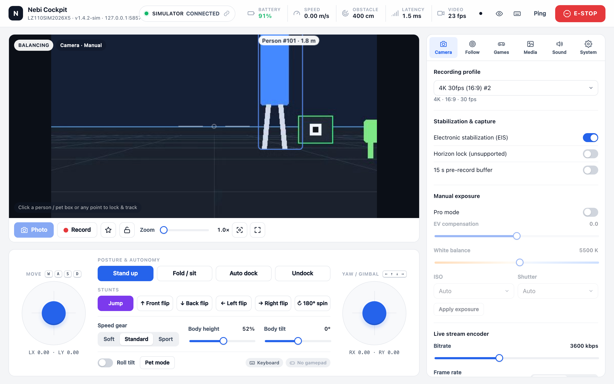

# nebi

**Control your Beni robot from your computer: a web cockpit, a JSON command line for scripts and AI agents, a Python
SDK, and a cute robot voice.** Everything talks to the robot directly over your local network. No cloud, no phone app.



> [!WARNING]
> **Unofficial project, not affiliated with the robot's manufacturer.** "Beni" and LZ110 / LZ100 only name the
> compatible hardware. Use it with a robot **you own**; it may void your warranty. The software **moves the robot**:
> supervise it and keep a clear space around it. Firmware update and factory reset can brick or wipe the device.
> Provided as is, without warranty ([Apache-2.0](LICENSE), see [NOTICE](NOTICE)).

> [!NOTE]
> **Work in progress.** Not everything may work on your robot. The protocol was worked out independently, firmware
> updates can change it, and some features are only tested in the simulator or on one robot (LZ110, firmware
> V26.10.28). If something does nothing or fails, check [Limitations](#limitations) and please open an issue.

## What you can do

- **Drive** with on-screen joysticks, WASD or a gamepad, watching the live camera with person and pet detection.
- **Do tricks:** stand up, sit, jump, flips, 180° spin, auto-dock.
- **Follow and track:** click a person in the video and the robot keeps them in frame or follows them.
- **Camera:** record 4K video, zoom, exposure, 46 recording profiles, and browse and download the robot's album.
- **Talk and listen:** two-way intercom from the browser, or type text and the robot says it in its own voice.
- **Eyes:** set any colour or play expressions on the LED eyes.
- **Health:** live faults with plain-English recovery hints, battery, temperature and Wi-Fi.
- **Script it or hand it to an AI agent:** every action is one bounded, safe command that returns JSON.
- **Try it without a robot:** a built-in simulator renders a 3D scene with people, so all of the above works offline.

## Install

Python 3.10 or newer.

```bash
pip install nebi-cli nebi-voice       # the `nebi` CLI + cockpit + SDK, and the robot voice
```

Or from source:

```bash
git clone https://github.com/lukaville/nebi && cd nebi
scripts/dev-setup.sh                  # creates .venv and installs everything
source .venv/bin/activate
```

## Connect your robot

The robot does not rejoin your Wi-Fi by itself after it is switched on, so after every power-on send it your Wi-Fi
details over Bluetooth (the first time, hold the robot's button for 3–5 seconds when asked):

```bash
nebi setup-wifi --ssid "MyWiFi" --password "secret"   # remembered: next time just `nebi setup-wifi`
```

Or use **Wake up over Bluetooth and connect to Home Wi-Fi** in the cockpit's connection menu, which does the same.

## Web cockpit

```bash
nebi-cockpit serve              # http://127.0.0.1:8000, then connect your robot from the menu
nebi-cockpit serve --sim        # try it with the built-in simulator instead
```

Drive with WASD (Space jumps), click a person in the video to track them, and use the tabs for camera, follow
modes, games, the media album, sound (intercom, speech, eyes) and system health.

## Command line (for scripts and AI agents)

Every command prints one JSON object and uses exit codes, so it is easy to script and easy for an LLM to drive.

```bash
nebi up --sim                     # connect: starts a small background service that holds the robot link
                                  # (or: nebi up --host 192.168.1.50; reuses the cockpit's link if it is running)
nebi stand
nebi look --annotate              # saves a camera JPEG and lists the people and pets it sees
nebi drive forward 50cm           # stops early for obstacles, always ends stopped
nebi turn left 90
nebi say "Ball? 👀"               # emoji pick the emotion
nebi eyes heart
nebi track 101 && nebi follow orbit --distance 2m   # a target id from `nebi look`
nebi wait 'targets>0' --timeout 30s
nebi stop                         # cancels any motion, from any terminal
nebi sit                          # fold the robot's legs: it sits down on the floor (safe resting pose)
nebi down                         # stop any motion, disconnect, stop the background service (does not sit)
```

```json
{"ok": true, "command": "drive", "result": {"traveled_m": 0.49, "stopped_reason": "reached", "summary": "drove forward 0.49 m of 0.50 m (reached)"}, "state": {"posture": "BALANCING", "battery": 91}}
```

`nebi guide` prints the manual written for AI agents; `nebi schema` lists every command and argument as JSON.

## Python

```python
import asyncio

from nebi import AsyncNebiClient


async def main() -> None:
    async with AsyncNebiClient("192.168.1.50") as robot:
        await robot.motion.stand()

        robot.motion.set_axes(ly=0.4)                 # drive forward at 40 %
        await asyncio.sleep(0.3)                      # (stick values expire after 0.5 s unless re-sent)
        robot.motion.set_axes(ly=0.0)

        await robot.eyes.set_color(0, 120, 255, hold_sec=5)
        await robot.camera.set_zoom(1.5)

        await robot.say("Hello!", emotion="happy")    # through the robot's speaker, waits until done

        print(robot.telemetry.battery_soc, robot.telemetry.posture_name)
        await robot.motion.fold()


asyncio.run(main())
```

No robot? Start the simulator first and connect to it instead:

```python
from nebi.simulator import MockNebiRobot

sim = MockNebiRobot()
await sim.start()
async with AsyncNebiClient(**sim.client_kwargs()) as robot:
    ...
```

## Robot voice

`nebi-voice` gives the robot a small, expressive pet voice (emotions, babble, pitch glides). Once installed it is
the default voice for the cockpit and `nebi say`; the model (~27 MB) downloads on first use.

```bash
nebi-voice say "Hello, I am Nebi." -e happy
nebi-voice say --babble -e curious
nebi-voice serve --open           # playground in the browser
```

## Packages

| Package | What it is |
|---|---|
| [`nebi`](nebi) | Async Python SDK and the robot simulator |
| [`nebi-cockpit`](nebi-cockpit) | The web cockpit (`nebi-cockpit`) |
| [`nebi-cli`](nebi-cli) | The `nebi` command line and its agent runtime |
| [`nebi-voice`](nebi-voice) | Robot-style text-to-speech, plugged in as an extension |
| [`nebi-patch`](nebi-patch) | Hardened firmware patcher, verifier and OTA uploader |

Add your own commands, cockpit panels, voices or sensors with an extension: see the
[nebi](nebi-lib/README.md#extensions) and [nebi-cli](nebi-cli/README.md#extensions-agent-side) READMEs.

## Limitations

- Choreographed firmware motions (dances) and still photos can't be triggered from outside the official app on
  current firmware. Record a clip instead, or grab a frame from the live video.
- Tested on the LZ110 with firmware V26.10.28. Other models and firmware versions may differ.

## More

- [Agent manual](nebi-cli/src/nebi_cli/GUIDE.md) (`nebi guide`)
- [Cockpit architecture](nebi-cockpit/docs/web-architecture.md)
- [Contributing](CONTRIBUTING.md) · [Security](SECURITY.md) · [Licence](LICENSE) · [Notice](NOTICE)
